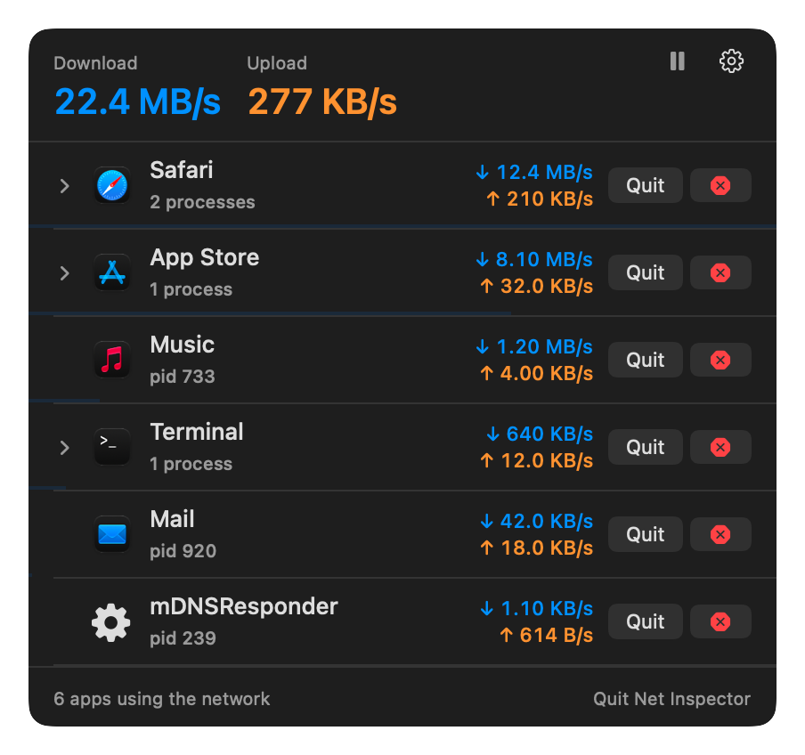

# Net Inspector

[](https://github.com/saifi369/macnetworkinspector/actions/workflows/build.yml)
[](LICENSE)


A tiny macOS menu bar utility that shows **which app is using how much of your
internet connection right now**, and lets you quit or force-kill the culprit
with one click.

Your speed-test widget says you are pulling 25 MB/s, but *what* is doing it?
Net Inspector answers that in one click.

<p align="center">
  
</p>
<p align="center">
  
</p>

<sub>Screenshots are rendered from demo data (`./build.sh --screenshots`); light mode looks like
<a href="docs/screenshots/popover-light.png">this</a>.</sub>

## Features

- Live download / upload speed in the menu bar.
- Click it for a per-app breakdown, busiest app first, with app icons and a
  usage bar.
- Helper processes are grouped under their app (Chrome/Brave/Safari helpers,
  XPC services, CLI tools launched from Terminal…). Expand a row to see them
  and kill them individually.
- **Quit** asks the app to quit nicely. **⛔** force-kills (asks for
  confirmation). Root-owned daemons prompt for your admin password.
- Settings (gear): MB/s or Mbps, what to show in the menu bar, refresh rate,
  Launch at Login.

No root, no kernel extension, no network filter, no telemetry: it reads the
kernel's per-socket byte counters through the same NetworkStatistics framework
that Activity Monitor and `nettop` use. It never touches your traffic, only the
byte counts, and it idles at well under 1% CPU.

## Install

Requires macOS 14 Sonoma or newer and Xcode (or the Command Line Tools) to build.

```bash
git clone https://github.com/saifi369/macnetworkinspector.git
cd macnetworkinspector
./build.sh --install    # build, copy to /Applications and launch
```

Other options:

```bash
./build.sh              # just build into build/Net Inspector.app
./build.sh --run        # build and launch from the build folder
```

The app is ad-hoc signed, so Gatekeeper will not complain about a build you
made yourself. "Launch at Login" works best once the app lives in
`/Applications`.

## How it works

- `NetworkStatisticsBackend` talks to the private `NetworkStatistics.framework`
  (loaded with `dlopen`, so there is no link-time dependency). The kernel
  reports every TCP/UDP socket with its owning pid; once per interval the
  backend asks for fresh counts and sums the byte deltas per process. This is
  event-driven and costs almost nothing. The framework also reports an
  "effective pid", so a download done by a system helper on behalf of an app
  is credited to that app.
- `NetTopBackend` is the fallback if that framework is ever unavailable: it
  runs `/usr/bin/nettop -P -d -L 0 …` behind a pseudo-terminal and parses its
  CSV output. nettop rescans every socket each interval and burns more than a
  full CPU core, so it is only used as a last resort (or when forced with
  `NETINSPECTOR_BACKEND=nettop`).
- `CPtySpawn` is a small C helper that spawns nettop as a session leader with
  the pty as its controlling terminal, so nettop is hung up and exits whenever
  the app goes away, even after a hard kill.
- `ProcessResolver` maps each pid to the application responsible for it using
  `responsibility_get_pid_responsible_for_pid` from libquarantine (the same
  call Little Snitch and LuLu use), then looks up name and icon through
  `NSRunningApplication`.
- `ProcessKiller` uses `NSRunningApplication.terminate()` /
  `forceTerminate()` for apps, `SIGTERM` / `SIGKILL` for everything else, and
  falls back to an administrator prompt when permission is denied.

## Limitations

- Speeds are sampled once per interval (1 s by default), so very short bursts
  can be averaged out.
- `NetworkStatistics.framework` and `responsibility_get_pid_responsible_for_pid`
  are private APIs. Both have been stable for many macOS releases. If Apple
  removes the former, the app falls back to `nettop`; if it removes the latter,
  processes are listed individually instead of grouped.
- Traffic from the kernel itself (e.g. some VPN tunnels) is attributed to
  `kernel_task`.

## Contributing

See [CONTRIBUTING.md](CONTRIBUTING.md). Issues and pull requests are welcome.

## License

[MIT](LICENSE) © 2026 M Saif Ullah
